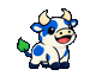
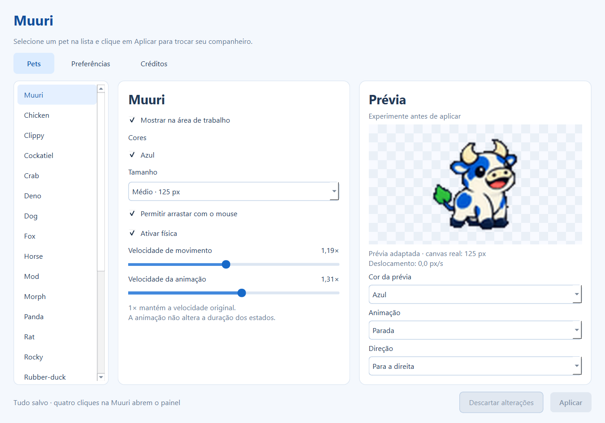

# Muuri 🐮

Uma vaquinha que vive no seu desktop.

<p></p>

Muuri é um desktop pet para Windows com animações, interação, arraste, física opcional e painel de configurações em português. É baseada no [DeskPets](https://github.com/Jumitti/DeskPets), mantendo Python/PyQt e os créditos da base original.

## ✨ Recursos

- Passeios pelo desktop, animações de descanso e reações.
- Arraste com o mouse e animação ao ser carregada.
- Física opcional com gravidade, arremesso e quique.
- Tamanhos e velocidades de movimento e animação independentes.
- Painel em português, seleção de outros pets e ícone na bandeja do Windows.
- Várias espécies ao mesmo tempo e quantidade de cópias por espécie/cor, sem teto fixo de pets no engine.
- Uma instância por sessão e preferências salvas entre execuções.
- Atualizações pelo próprio aplicativo no Windows, com download verificado e preferências preservadas.

Na versão 1.2.0 ou superior, use **Preferências → Atualizações** ou o aviso da
bandeja para atualizar sem procurar e baixar o instalador no navegador.
Quem usa uma versão anterior precisa instalar a 1.2.0 uma vez.
Veja [como funcionam as atualizações](UPDATES.md).

## 📦 Instalação

1. Abra [Releases](https://github.com/Felipx423/muuri/releases/latest).
2. Baixe **Muuri-Setup.exe**.
3. Execute o instalador e conclua a instalação.
4. Abra **Iniciar Muuri** pelo atalho ou pelo menu Iniciar.

Para **Windows 10/11 de 64 bits**. Não precisa de Python nem VS Code. O aplicativo ainda não possui assinatura digital própria. Para remover, use **Configurações do Windows → Aplicativos**; as preferências ficam preservadas.

Para **macOS Apple Silicon (M1 ou posterior)**, baixe o DMG na [prévia para Mac](https://github.com/Felipx423/muuri/releases/tag/muuri-v1.0.2-macos-preview.1), arraste `Muuri.app` para Applications e abra pelo Finder. É uma versão experimental, ainda sem notarização Apple. Consulte [packaging/MACOS.md](packaging/MACOS.md) para detalhes de instalação, limitações e compilação.

## 🐮 Como usar

- Dê **quatro cliques rápidos** na Muuri para abrir o painel.
- Arraste com o mouse. Para gravidade e arremesso, marque **Ativar física** e clique em **Aplicar**.
- Ajuste tamanho, cores, velocidades, pet e camada no painel. A prévia não altera o pet até aplicar.
- Para manter vários pets juntos, clique nos cartões desejados e ajuste **Quantidade** para criar cópias. Cada cartão mantém os demais ativos. Para remover uma espécie, desmarque **Mostrar na área de trabalho** nela. Confirme em **Aplicar**.
- Para remover cópias, use **Remover 1** ou diminua **Quantidade**. **Remover espécie** e quantidade **zero** retiram todas as cópias dessa espécie. **Remover todos os pets** limpa a tela. Confirme em **Aplicar**; o ícone da bandeja continua disponível.
- Use o ícone na bandeja, perto do relógio, para abrir as configurações ou **Sair**.

## 🖼️ Screenshots



## 🛠️ Executar pelo código

No Windows, na raiz do projeto:

```powershell
python -m venv .venv
.\.venv\Scripts\python.exe -m pip install -r requirements.txt
.\.venv\Scripts\python.exe run.py
```

## 🧪 Testes

Com o ambiente virtual ativado:

```powershell
python -m unittest discover -s tests -v
```

Ou use diretamente `.\.venv\Scripts\python.exe` no lugar de `python`.

Para executar os testes com preferências temporárias, sem depender das velocidades e pets configurados localmente, use `python packaging/run_tests.py`. No macOS, os testes Win32 ficam pulados e os testes Qt/Cocoa cobrem a integração da plataforma.

## 📦 Build

Consulte [packaging/README.md](packaging/README.md) para compilar o executável e o instalador. O launcher continua sendo `run.py`. O [histórico de desenvolvimento](MUURI_INTEGRATION.md) registra etapas intermediárias, não instruções atuais.

## 📜 Créditos e licenças

- **DeskPets**, por **Minniti Julien (Jumitti)**: [repositório original](https://github.com/Jumitti/DeskPets). A licença MIT e seu aviso de copyright estão preservados em [LICENSE](LICENSE).
- **vscode-pets**, por **tonybaloney**: [projeto de inspiração da base](https://github.com/tonybaloney/vscode-pets). Os créditos e condições aplicáveis aos assets herdados continuam válidos.
- **Muuri**: design de referência fornecido pelo usuário; animações adaptadas para esta integração.
- **PyQt6**: a distribuição executável usa GPL v3 e inclui a licença, os fontes da aplicação e os assets necessários. As licenças das demais bibliotecas acompanham o instalador em `_internal/THIRD_PARTY_LICENSES`.

O ZIP de fonte incluído no instalador reutiliza os assets de `_internal/deskpets/media`. Após extrair o fonte, copie essa pasta para `deskpets/media` antes de compilar; o ZIP autônomo disponível nas versões já inclui os assets.

O pacote interno `deskpets`, o identificador do instalador, o mutex de instância única e a pasta instalada `MuuriDeskPets` permanecem por compatibilidade. Isso preserva imports, atualizações, preferências e a proteção contra instâncias duplicadas.
